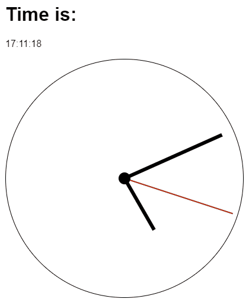

# React useClock [](https://www.npmjs.com/package/react-use-clock) 

Simplified access to current hours, minutes, seconds.

[](https://react-use-clock.netlify.app)

## Installation

```bash
npm install react-use-clock
```

## How to use

```jsx
import { useClock } from 'react-use-clock'

const MyClockComponent = () => {
	const clock = useClock()

	return (
		<div>
			<p>
				Time is:{' '}
				<strong>
					{clock.hours.toString().padStart(2, '0')}:
					{clock.minutes.toString().padStart(2, '0')}:
					{clock.seconds.toString().padStart(2, '0')}
				</strong>
			</p>
			<p>
				Date is:{' '}
				<strong>
					{clock.day}. {clock.month}. {clock.year}
				</strong>
			</p>
			<p>
				Using formatter:{' '}
				<strong>
					{clock.date.toLocaleTimeString('en', {
						day: 'numeric',
						month: 'long',
						year: 'numeric',
					})}
				</strong>
			</p>
			<div
				style={{
					'--hours': `${clock.hours}`,
					'--minutes': `${clock.minutes}`,
					'--seconds': `${clock.seconds}`,
				}}
			/>
		</div>
	)
}
```

Create your own wrapper component. You can get inspired by [Example here](src/stories/Example.tsx) and [Storybook here](https://react-use-clock.netlify.app).

## Granularity

By default the clock ticks every second. If you only display minutes, hours or
the date, pass a coarser `granularity` to avoid unnecessary re-renders – the
component then re-renders only once per chosen unit and the lower fields are
zeroed.

```jsx
// Re-renders once per minute, seconds are always 0.
const clock = useClock({ granularity: 'minute' })
```

Supported values: `'second'` (default), `'minute'`, `'hour'`, `'day'`.

```ts
useClock(options?: {
	granularity?: 'second' | 'minute' | 'hour' | 'day'
	initialValue?: ClockSnapshot // server snapshot / first render
	getDate?: () => Date // custom time source, e.g. for testing
})
```

> **Migrating from 1.x:** the hook now takes a single options object instead of
> positional arguments. Replace `useClock(initialValue, getDate)` with
> `useClock({ initialValue, getDate })`.

## Development

Run `npm start` and `npm run storybook` parallelly.
